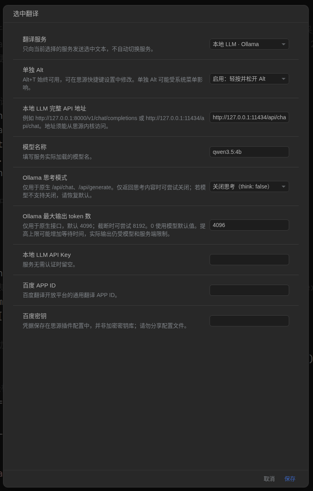

# siyuan-translation

面向思源笔记 3.8.5+ 的桌面端 / 桌面浏览器插件。选中笔记正文中的英文，默认按 **Alt+T**（可修改为**Alt**），在弹窗查看和复制中文译文。不会自动改写笔记。

## 安装

1. 在本项目执行 `npm run build`（只需 Node.js 和 Python 3，无需 npm install）。
2. 在思源工作空间的 `data/plugins/` 下新建 `siyuan-translation` 文件夹。
3. 将 `dist/package.zip` 解压到该文件夹，确保 `plugin.json` 直接位于文件夹下。
4. 在思源「设置 → 集市 → 已下载 → 插件」中启用「选中翻译」。若未显示，重启思源。
5. 打开插件设置，配置服务并保存。

当前为 0.2.0 待发布版本。

## 快捷键

- 默认 Alt+T，可在思源快捷键设置中修改「翻译选中的英文」。
- 若要单独按 Alt，在插件设置中启用「单独 Alt」，选中文字后轻按并松开 Alt。（推荐）
- Alt 与其他键组合、长按或窗口失去焦点不会触发单独 Alt 翻译。操作系统可能截获 Alt；遇到此情况使用 Alt+T。
- 仅处理笔记正文中的文本选择，设置输入框和译文弹窗不会触发翻译。

## 本地 Docker LLM

选择匹配的接口类型，填写**完整接口地址**和实际模型名：

| 类型 | 地址示例 |
| --- | --- |
| OpenAI 兼容服务（如 vLLM、LocalAI） | `http://127.0.0.1:8000/v1/chat/completions` |
| Ollama 原生接口 | `http://127.0.0.1:11434/api/chat` |
| Ollama 文本生成接口 | `http://127.0.0.1:11434/api/generate` |

0.1.1 会根据上述 URL 后缀匹配请求格式，并识别三种响应结构。`/api/generate` 使用 `prompt`，`/api/chat` 使用 `messages`。

若提示模型仅返回思考内容，可在「Ollama 思考模式」中尝试关闭思考，或改用非推理模型。默认不覆盖模型的思考配置；并非所有模型都支持关闭思考。思考内容不会当作译文显示。

升级：先禁用插件，用新版安装包覆盖原插件目录中的文件，然后重新启用插件；无需卸载或删除配置。

### Ollama 输出截断（0.1.2）

原生接口请求默认设置 `options.num_predict: 4096`，可在「Ollama 最大输出 token 数」中调整；填写 `0` 则不传此参数，沿用模型默认值。若仍提示达到输出上限，可尝试 `8192`，或缩小选中范围。提高上限不能保证模型完成翻译，并且可能增加等待时间；插件仍保留原有超时限制。

若模型只返回思考内容就达到上限，可以尝试关闭思考，或使用非推理模型。新版将截断后的部分译文保留在弹窗，并明确标记为未完成；思考字段不会当作译文显示。OpenAI 兼容接口和百度不发送 Ollama 的 `num_predict` 参数。

API Key 在服务不要求认证时留空。插件不启动模型容器，请先部署并映射服务端口。

请求经思源内核 `/api/network/forwardProxy` 发出，因此地址必须从**思源内核所在环境**可达。若思源也在 Docker 中，`127.0.0.1` 指思源容器自身；同一 Docker 网络下可以填写模型容器的服务名和容器端口。桌面应用连接本机映射端口时可使用上表地址。

## 百度翻译

选择「百度通用翻译」，填写百度翻译开放平台的 APP ID 和密钥，并开通通用翻译服务。仅选择百度时，选中文本才会发送至百度；本地服务失败不会自动回退到百度。百度计费、配额以你的账户为准。

## 使用限制

- 每次最多 6000 UTF-8 字节；长段落请分次选中。
- 同时只执行一个请求，等待最长约 125 秒。关闭弹窗或点击取消会停止等待，服务端可能继续推理。
- 凭据使用思源插件配置存储，不是加密密钥库；不要分享配置文件。
- 译文按纯文本展示，模型输出不会作为 HTML 执行。
